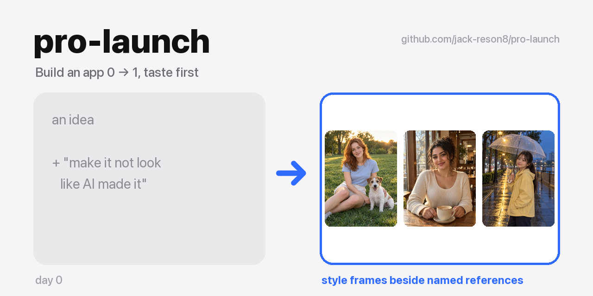

# pro-launch

[English](README.md) | [简体中文](README.zh-CN.md) | [日本語](README.ja.md) | 한국어 | [Tiếng Việt](README.vi.md) | [हिन्दी](README.hi.md)

<p align="center"></p>
<p align="center"><sub><a href="https://github.com/jack-reson8/copy-that"><b>Copy That</b></a> 시리즈 · 한 줄로 전체 설치</sub></p>

제품을 0에서 1로 **감각 우선**으로 끌고 가는 Claude Code 스킬입니다. 포지셔닝 → 네이밍·도메인·상표 → 레퍼런스 탐색(GitHub/오픈소스 먼저, 그다음 App Store와 수상작) → 스타일 바이블 → 기능 맵 → UI/UX 빌드 루프 → 에셋 생성 → 실기기 QA → 런칭 영상 → GTM → 그로스 → 오픈소스 / App Store 출시까지 다룹니다.

만든 이유: AI가 만든 제품이 실패하는 건 대부분 코드 때문이 아닙니다. (1) 진짜 레퍼런스를 연구하지 않았고, (2) 모델이 자기 결과물을 스스로 채점하고, (3) 사용자가 반복해서 하는 지적이 어디에도 기록되지 않기 때문입니다. 그래서 모든 단계에서 **실제 산출물**을 만들게 하고, 다음 단계로 넘어가기 전에 **게이트**(`scripts/phase_gate.py`)를 통과하도록 했습니다.

## 설치

Claude Code에서:

```
/plugin marketplace add jack-reson8/pro-launch
/plugin install pro-launch@pro-launch
```

일반 스킬 폴더로 설치하려면:

```bash
git clone https://github.com/jack-reson8/pro-launch /tmp/pro-launch && cp -R /tmp/pro-launch/plugins/pro-launch/skills/pro-launch ~/.claude/skills/
```
설치 후 Claude Code에 "앱 만들어줘", "이 UI 너무 흔해 보여", "레퍼런스 찾아줘", "이 제품 이름 지어줘", "런칭 계획 세워줘" 같이 말해 보세요.

**Codex**(CLI 또는 ChatGPT 데스크톱 앱):

```bash
codex plugin marketplace add jack-reson8/pro-launch
codex plugin add pro-launch@pro-launch
```

`plugins/pro-launch/skills/pro-launch`를 `~/.codex/skills/`에 복사해도 됩니다. 이 스킬은 오픈 [Agent Skills](https://agentskills.io) 표준을 따르므로 Claude Code, Codex, 그리고 SKILL.md를 읽는 모든 에이전트에서 동작합니다.

**기타 에이전트**(Cursor, Gemini CLI, GitHub Copilot 등 skills CLI가 지원하는 에이전트):

```bash
npx skills add jack-reson8/pro-launch
```

## 구성

스킬은 `plugins/pro-launch/skills/pro-launch`에 있으며, 아래 경로는 모두 이 폴더 기준입니다.

- `SKILL.md` – 단계, 게이트, 철칙
- `references/01-13` – 단계별 한 페이지(다국가 출시를 위한 상표·지식재산 포함)
- `references/mistakes.md`, `user-repeated-demands.md` – 실제 실수 기록과 사용자가 반복하는 요구 사항
- `scripts/` – 단계 게이트, App Store 포스터 다운로더, 레퍼런스 아카이버, 도메인 / App Store 이름 중복 확인, 누끼→벡터 파이프라인(Vision + vtracer + svgo)
- `examples/`, `assets/` – 실전 예시와 템플릿

MIT 라이선스. Claude Code 스킬로 동작하며, 이 방법론은 다른 에이전트에도 그대로 옮겨 쓸 수 있습니다.
